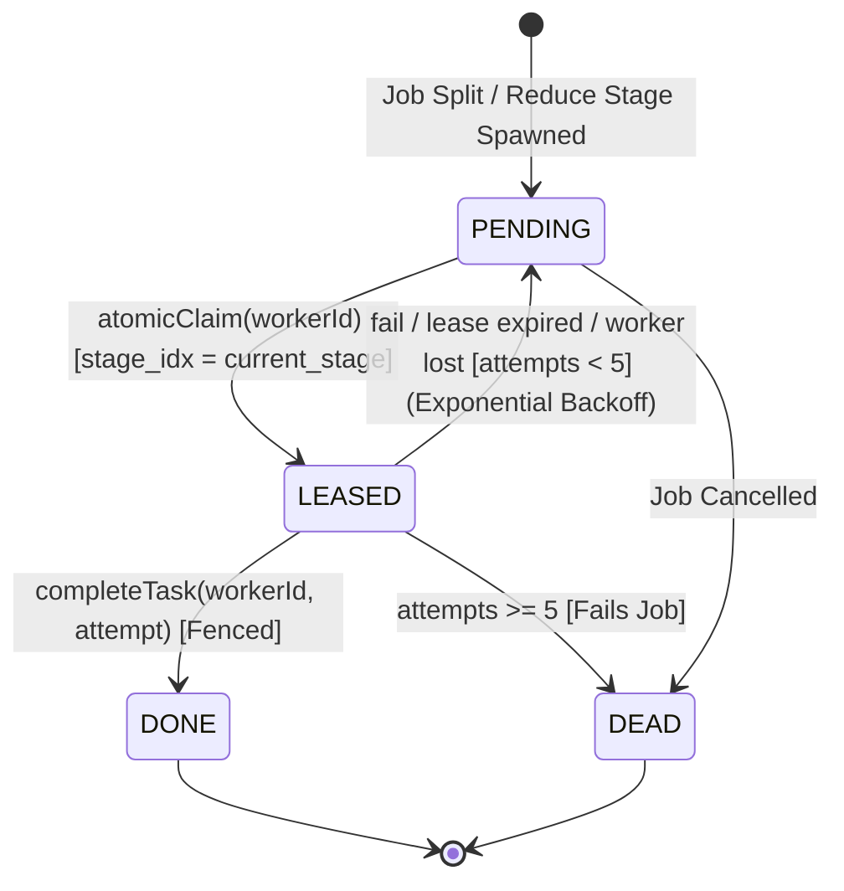
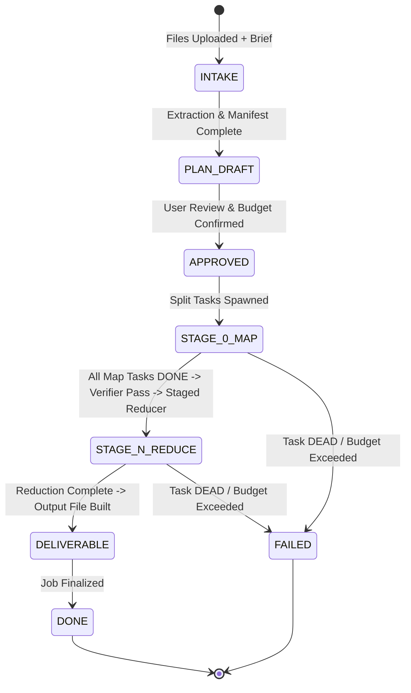

# Relay: Architecture and Distributed Systems Design

Relay is a distributed task platform engineered to demonstrate core distributed-computing guarantees under concurrency, network delays, and process failures. In V3, Relay introduces the end-to-end autonomous pipeline: **"Upload anything, tell us what you want, we get it done."**

---

## 1. System Architecture

```mermaid
flowchart TD
    Client["Client Web App (React 18 + Vite)"]
    SSE["SSE Stream (/api/stream)"]
    REST["REST API (/api/*)"]

    subgraph Coordinator["Relay Coordinator (Single OS Process)"]
        Fastify["Fastify HTTP Server + Multipart"]
        Broker["SSE Event Broker"]
        Supervisor["Process Supervisor"]
        Sweeper["Sweeper & Pipeline Orchestrator (500ms)"]
        Intake["Deterministic Intake & Zip Slip Guard"]
        Planner["AI Planner & Estimator (Sonnet / Fake Model)"]
        LLMProxy["LLM Proxy (Semaphore Concurrency + Budget Guard)"]
        Verifier["Quality Verifier (Spot-Check Sampling)"]
        Deliverable["Deliverable Assembler (MD, DOCX, XLSX, CSV, ZIP)"]
        SQLite[("SQLite WAL Database\n(Atomic Transactions & Fencing)")]
    end

    subgraph WorkerPool["Managed Worker Pool (Independent OS Processes via child_process.fork)"]
        W1["Worker 1 (PID A)\n[Heartbeat Loop | Claim Loop | Tool Runner | LLM Client]"]
        W2["Worker 2 (PID B)\n[Heartbeat Loop | Claim Loop | Tool Runner | LLM Client]"]
        W3["Worker 3 (PID C)\n[Heartbeat Loop | Claim Loop | Tool Runner | LLM Client]"]
    end

    Client -->|Upload Brief & Files| REST
    REST --> Fastify
    Broker -->|Real-time SSE Events| SSE
    SSE --> Client

    Fastify --> SQLite
    Sweeper --> SQLite
    Supervisor -->|SIGKILL / Fork| WorkerPool
    WorkerPool -->|Atomic Claim / Heartbeat / Complete| Fastify
    WorkerPool -->|LLM Requests (Zero-Trust)| LLMProxy
```

---

## 2. V3 Autonomous Pipeline Flow

```
Upload + Brief ──► INTAKE ──► PLAN ──► APPROVE ──► SPLIT ──► MAP (Workers) ──► REDUCE (Workers, Staged) ──► VERIFY ──► DELIVER
```

### 2.1 Deterministic Intake
- **Upload Protection:** 500 MB maximum upload size, 2,000 maximum files limit.
- **Zip Slip Guard:** Strict sanitization of relative paths (`..`, absolute paths, Windows separators) in [intake.ts](file:///d:/DC/apps/server/src/intake/intake.ts).
- **Format Extractors:**
  - PDF: `pdf-parse` (Uint8Array binary extraction)
  - Word: `mammoth` (raw text extraction)
  - Tabular: `xlsx` & `papaparse` (structured JSON row objects)
  - Text & Code: Direct UTF-8 decoding
  - Images: Preserved for vision analysis and Jimp processing
- **Manifest Persistence:** Extracted metadata stored in `data/jobs/<id>/extracted/<fileId>.json`.

### 2.2 AI Planner & Structured Output
- **Model:** `claude-sonnet-5-5` (or deterministic offline simulation when `RELAY_FAKE_LLM=1` or `ANTHROPIC_API_KEY` is absent).
- **Structured Output:** Strictly enforced via Anthropic tool use and Zod schema validation ([planner.ts](file:///d:/DC/apps/server/src/ai/planner.ts)).
- **Safety Rule:** The planner **never executes or generates arbitrary code**. It only selects from a registered whitelist of safe operations:
  - Tools: `image_resize`, `image_convert`, `csv_clean`, `csv_stats`, `text_extract`, `hash_files`, `json_to_csv`, `translate`, `summarize`, `extract_fields`, `classify`.
  - Reduce ops: `concat`, `merge_json`, `table_union`, `llm_synthesis`.
- **Cost Estimator:** Deterministic token and pricing calculation using the Sonnet/Haiku rate table. Costs exceeding `$5.00` require explicit confirmation.

### 2.3 Splitter & Chunking Strategies
- `per_file`: 1 task per file.
- `chunk_text`: Text chunked by token count (`targetTokens * 4` chars) breaking on sentence or paragraph boundaries.
- `chunk_rows`: Slices tabular CSV/Excel rows into batches of `target` (default 500 rows).
- `page_groups`: PDF page grouping for document processing.
- `single`: Single monolithic task for unified metadata.

### 2.4 Worker Execution & Coordinator Proxy
- **Zero-Trust Workers:** Worker processes never hold the Anthropic API key.
- **Coordinator LLM Proxy:**
  - Authenticated via task lease tokens.
  - Concurrency capped using async Semaphore (`LLM_MAX_CONCURRENCY`, default 8).
  - Rate limiting handling with exponential backoff on HTTP 429/529.
  - Hard budget enforcement: If accumulated cost reaches `job.budget_usd`, execution halts immediately with `BUDGET_EXCEEDED`.
  - Recorded in `llm_calls` table (tokens in/out, latency ms, cost USD).
- **Offline / Fake Model:** Simulated latency (50-150ms) and schema-conforming deterministic mock output.

### 2.5 Staged Tree Reduction
- When all stage $N$ tasks are `DONE`, the sweeper evaluates reduction rules.
- If `plan.reduce.op === 'llm_synthesis'` and task count $> \text{fanIn}$ (default 20), creates intermediate stage $N+1$ batches.
- Workers pull and execute reduce tasks identically to map tasks.
- Pure deterministic reduction (`table_union`, `concat`, `merge_json`) runs seamlessly with zero token overhead.

### 2.6 Quality Verification Spot-Check
- Evaluates `min(5, ceil(10% of map tasks))` outputs using planner spot-checks ([verifier.ts](file:///d:/DC/apps/server/src/pipeline/verifier.ts)).
- Assesses structural validity and instruction compliance.
- If quality issues detected, flags the job with `needs_review: true` in the UI while preserving the final deliverable for user download.

### 2.7 Multi-Format Deliverable Generation
- `md`: Synthesized Markdown with headers, executive summaries, and tables.
- `csv`: Generated via `papaparse`.
- `xlsx`: Built via `exceljs` with styled header columns and auto-fitting.
- `docx`: Compiled via `docx` library with title and structured headings.
- `json`: 2-space indented pretty JSON.
- `zip`: Multi-file packages (such as resized images) compiled via `adm-zip`.

---

## 3. Distributed Systems Guarantees & File Mapping

| Distributed Concept | Description | Implementation File & Function |
|---|---|---|
| **Work Partitioning** | Deterministic split/map/reduce of jobs into discrete bounded tasks | [splitter.ts](file:///d:/DC/apps/server/src/pipeline/splitter.ts), [primes.ts](file:///d:/DC/apps/server/src/workloads/primes.ts) |
| **Pull-Based Load Balancing** | Workers pull work at their own capacity rather than coordinator pushing | [main.ts](file:///d:/DC/apps/server/src/worker/main.ts) (`claimAndExecute`) |
| **Atomic Claim** | Single SQLite transaction guarantees no two workers receive the same task | [repo.ts](file:///d:/DC/apps/server/src/db/repo.ts) (`Repository.atomicClaim`) |
| **Failure Detection** | Heartbeat interval (1s) and timeout (4s) detect silent worker crashes | [sweeper.ts](file:///d:/DC/apps/server/src/sweeper/sweeper.ts), [main.ts](file:///d:/DC/apps/server/src/worker/main.ts) |
| **Fault Tolerance & Leases** | Leased tasks expire if heartbeats cease; open attempts marked LOST | [repo.ts](file:///d:/DC/apps/server/src/db/repo.ts) (`requeueTasksForWorker`, `requeueExpiredTask`) |
| **Retries & Exponential Backoff** | Failed tasks retried with exponential delay: $\min(8000, 500 \cdot 2^{a-1})$ | [config.ts](file:///d:/DC/packages/shared/src/config.ts) (`calculateBackoff`), [repo.ts](file:///d:/DC/apps/server/src/db/repo.ts) |
| **Dead-Letter State** | Tasks reaching `MAX_ATTEMPTS` (5) transition to `DEAD`, cleanly failing the job | [repo.ts](file:///d:/DC/apps/server/src/db/repo.ts) (`Repository.failTask`) |
| **Fencing (Zombie Protection)** | Completed / failed submissions carry `(workerId, attempt)`; stale returns HTTP 409 | [repo.ts](file:///d:/DC/apps/server/src/db/repo.ts) (`completeTask`), [routes.ts](file:///d:/DC/apps/server/src/api/routes.ts) |
| **At-Least-Once Execution** | Tasks are pure deterministic functions of payload, safe to re-execute | [main.ts](file:///d:/DC/apps/server/src/worker/main.ts), [primes.ts](file:///d:/DC/apps/server/src/workloads/primes.ts) |
| **Non-Blocking Heartbeats** | Heavy compute runs in `worker_threads` so CPU work never starves heartbeats | [main.ts](file:///d:/DC/apps/server/src/worker/main.ts), [thread-worker.ts](file:///d:/DC/apps/server/src/worker/thread-worker.ts) |
| **Supervision & Process Lifecycle** | Auto-spawn, graceful scale, hard crash simulation (`SIGKILL`), boot recovery | [supervisor.ts](file:///d:/DC/apps/server/src/supervisor/supervisor.ts) (`Supervisor`) |

---

## 4. State Machines

### 4.1 Task State Machine



### 4.2 Job & Stage State Machine



---

## 5. Security & Isolation Model

1. **Zip-Slip Mitigation:** Validates canonical paths before extraction; blocks relative upward traversals (`..`) and absolute targets.
2. **Deterministic Whitelist:** Code generation is prohibited. Only pre-compiled safe tools and deterministic reductions are executable by workers.
3. **Budget Caps:** Coordinator LLM proxy terminates jobs before exceeding budget thresholds, preventing runaway API consumption.
4. **Offline Determinism:** Full system runs end-to-end with `RELAY_FAKE_LLM=1` without external network dependencies.
